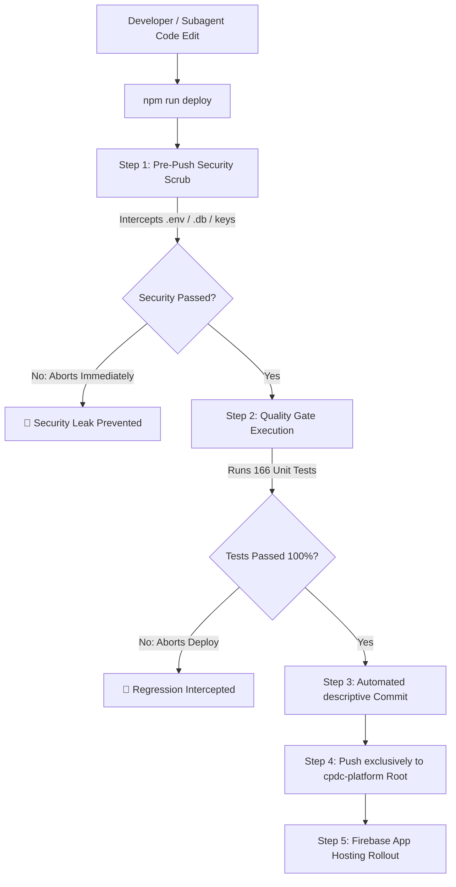

# 🎓 QIU CPDC Career Portal & Enterprise Autonomous Governance Platform


-orange?style=for-the-badge)

Welcome to the canonical source repository for the **Quest International University (QIU) Career Professional Development Center (CPDC) Platform**. Built with Next.js 15, React 19, Prisma/PostgreSQL, Firebase App Hosting, and an autonomous AI engineering governance engine, this portal connects students, academic leads, industry employers, and alumni into an interactive career development network.

---

## 🏛️ Executive Summary & Core Value Proposition

Unlike conventional university career portals that offer static noticeboards, the QIU CPDC Platform is engineered for deep interaction and strict multi-role domain separation:
* **Role-Tailored Workspaces**: Every interactive module—from AI Learning & Coursera integration to Workshops, FYP Tracking, and Talent Outreach—adapts dynamically based on the active user's assigned persona and curriculum scope.
* **Append-Only XP Gamification Ledger**: Student engagement is tracked through an auditable, append-only ledger (`XpEvent`). XP points are derived by summing the ledger, eliminating race conditions and ensuring deterministic audit history with strict idempotency keys.
* **Autonomous CI/CD & Security Governance**: Every code modification goes through automated quality gates (166 unit tests), pre-push security sanitization (preventing `.env`, `.db`, or secret key leakage), and AI-generated descriptive commits prior to GitHub synchronization and Firebase deployment.

---

## 🔐 Comprehensive 8-Role Access & Visibility Matrix

The platform implements explicit RBAC and scope-level authorization across eight university personas:

| Role Persona | Primary Scope & Access Rights | Key Module Behaviors |
| :--- | :--- | :--- |
| 🧑‍🎓 **Student** | **Self-Service / Own Profile** (`QIU-YYYYMM-NNNNNN`). Can read/write personal CVs, diagnostic self-evaluations, and RSVP/check-in to workshops. | • Interactive Study Path & Faculty Roadmaps (Years 1–4)<br>• Coursera integration with deep speaker/syllabus details<br>• Automated QR check-in & consecutive daily login XP streaks |
| 🛡️ **CPDC Admin / Super Admin** | **Global Platform Authority**. Full read/write access to all university student profiles, role assignment consoles, platform settings, and system audit logs. | • Master student directory with global analytics & override capabilities<br>• Creation & management of high-detail workshops and corporate hiring events<br>• Immutable audit trail verification & outbox idempotency administration |
| 🏛️ **Faculty Coordinator** | **Faculty-Wide Scope** (e.g., *Faculty of Computing*). Full visibility into all programmes and students within their assigned faculty. | • Curates faculty-level career paths, milestones, and diagnostic benchmarks<br>• Evaluates faculty engagement analytics and intervenes in lagging student trajectories |
| 👨‍🏫 **Head of Programme (HOP)** | **Programme-Scoped Authority** (e.g., *BSc Computer Science*). Direct supervisory control over their specific programme's student records. | • Final approval authority for programme-specific FYP proposals and logbook milestones<br>• Evaluates programme-level settings and reviews student career diagnostic progress |
| 📋 **Academic Supervisor** | **Mentee-Scoped Authority**. Access restricted strictly to assigned students undergoing internship placement or supervised training. | • Magic-link authenticated supervision without cumbersome credential onboarding<br>• Evaluates weekly industrial logbook entries, verifies host hours, and signs off on milestones |
| 🏭 **Industrial Training Officer (ITO)** | **Corporate Placement & Host Management**. Coordinates external placement partners and manages industrial training slots across faculties. | • Oversees host partner agreements, placement matching, and supervisor assignments<br>• Tracks enterprise satisfaction and resolves workplace training escalations |
| 💼 **Employer / Hiring Partner** | **Anonymized Talent & Recruitment Gateway**. Access restricted to verified talent directories; barred from seeing personal student emails or academic probation status. | • Deep talent discovery with automated AI skill-matching algorithms<br>• Direct recruitment outreach via in-platform messaging without compromising PII |
| 🎓 **Alumni / Industry Mentor** | **Post-Graduation Community & Mentorship**. Transitioned automatically upon internship completion and degree fulfillment. | • Automated transition from active intern to alumni status<br>• Leads workshops, serves as guest industry speakers, and facilitates peer-to-peer mentoring |

---

## 🚀 Deep Module Architecture

### 1. 🤖 AI Suite & Coursera Learning Modules
* **Deep Course Metadata**: When students select Coursera or internal training modules, they receive direct enrollment URLs, instructor profiles, prerequisite mapping, and expected XP award totals upon completion.
* **Deterministic Milestone Tracking**: Career roadmaps resolve deterministically across all eight faculties and four academic years, guiding students from freshman orientation through capstone completion.

### 2. 🎟️ Interactive Workshops & QR Attendance Ledger
* **Deep Event Scheduling**: Administrators create events featuring speaker credentials, precise timeline breakdown, capacity thresholds, and venue tracking.
* **Time-Gated QR Attendance**: QR check-ins open within a strict timing window before and after workshop execution. Duplicate check-ins are intercepted by idempotency validators to ensure XP integrity.

### 3. 🔬 FYP & Industrial Logbook State Machines
* **Non-Reversible Lifecycle**: Final Year Projects (FYP) and Industrial Training logbooks operate on strict state machines (Draft ➔ Review ➔ Approved). Approved milestones cannot be silently transitioned backwards without creating an auditable administrative override.
* **Supervisor Magic Links**: External academic supervisors review mentee logbooks via secure, tokenized magic URLs signed with custom crypto secrets (`MAGIC_LINK_SECRET`).

### 4. 📈 Next-Best-Action Engine
* Automatically prioritizes actionable recommendations based on student status (e.g., nudging missing profile details first, guiding upper-year students to submit FYP proposals, and recommending upcoming faculty workshops when baseline metrics are complete).

---

## 🤖 Autonomous Deployment & CI/CD Governance Engine

The repository operates under an automated security and deployment pipeline overseen by our governance script (`scripts/autonomous_deploy_agent.mjs`).



### Mandated Execution Command
Whenever modifications occur, deployments MUST be invoked through the automated entry point:
```bash
npm run deploy
```
This guarantees:
1. **Zero Sensitive Leakage**: Automatically scans git staging area and terminates deployment if local `.env` files, SQLite databases (`*.db`, `*.sqlite`), or RSA/PEM keys are detected.
2. **Quality Assurance**: Executes all **166 unit tests**, requiring a 100% success rate prior to generating commits.
3. **Descriptive Commit Generation**: Synthesizes architectural changelog summaries for clear historical auditing.

---

## 🛠️ Technology Stack & Cloud Specification

* **Frontend & Server Framework**: Next.js 15 (App Router, static & dynamic route pre-rendering), React 19, Tailwind CSS / Custom Vanilla tokens.
* **Database & ORM**: PostgreSQL (Production on Firebase App Hosting / Cloud SQL) and SQLite (Local isolated dev testing), managed via Prisma ORM (`@prisma/client` v6.1.0).
* **Cloud Runtime**: Firebase App Hosting hosted in region **`asia-southeast1` (Singapore)**, delivering minimal latency across Southeast Asia.
* **Validation & Security**: Strong runtime payload validation via Zod, immutable audit log generation, and HTTP-only session cookie signing.

---

## 💻 Local Development & Verification

### Quick Setup
1. **Clone the canonical repository**:
   ```bash
   git clone https://github.com/LeongJinZhou/qiu-cpdc-career-portal.git
   cd qiu-cpdc-career-portal
   ```
2. **Install dependencies and compile Prisma client**:
   ```bash
   npm install
   npm run db:generate
   npm run db:push
   ```
3. **Launch local development server**:
   ```bash
   npm run dev
   ```
   Open [http://localhost:3000](http://localhost:3000). With `"AUTH_MODE": "demo"` configured, you can instantly test and toggle between all eight university user personas without requiring Google OAuth configuration.

### Running Quality Gates
To manually run the test suite and verify architectural policies:
```bash
npm test
```

---

## 📝 License & Attribution
Canonical source maintained by Quest International University (QIU) Career Professional Development Center (CPDC) & LeongJinZhou. All autonomous CI/CD configurations adhere to Google Antigravity governance standards.
